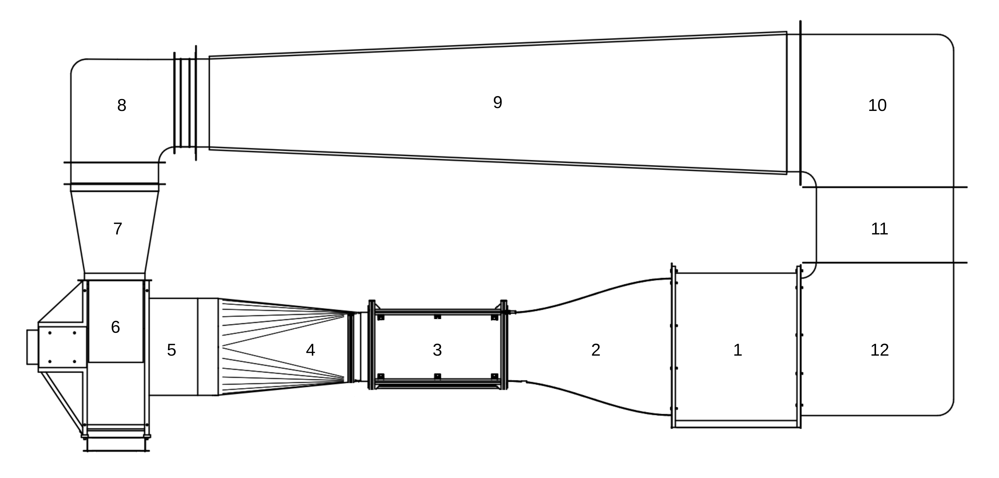

import Quiz from '@site/src/components/Quiz';

# The Wind Tunnel

This chapter describes the PROTOFLOW facility: its layout, its components, and the design choices behind them.

## Overall layout

PROTOFLOW is a **closed-circuit** wind tunnel. Air circulates continuously around a loop rather than being drawn from the room. The circuit lies in a single vertical plane, with the return leg stacked above the test section to minimise floor area.

The flow path, starting from the settling chamber:

| # | Component | Function |
|---|---|---|
| 1 | Settling chamber | Removes large-scale turbulence via honeycomb and screens |
| 2 | Contraction | Accelerates flow from 1000 × 1000 mm to 500 × 500 mm (ratio 4:1) |
| 3 | Test section | 500 × 500 mm, 1000 mm long — where models are installed |
| 4 | Diffuser 1 | Decelerates flow from square 500 × 500 to circular ∅710 mm |
| 5 | Flexible sleeve | Vibration decoupling between diffuser and fan |
| 6 | Centrifugal fan | Drives the flow; turns it 90° from axial to vertical |
| 7 | Diffuser 2 | Converts fan outlet (900 × 437 mm) to square 701 × 701 mm |
| 8 | Corner 1 | First vaned 90° turn |
| 9 | Diffuser 3 | Expands flow back to 1000 × 1000 mm (upper return leg) |
| 10 | Corner 2 | Second vaned 90° turn |
| 11 | Vertical return duct | Connects upper and lower legs |
| 12 | Corner 3 | Third vaned 90° turn, returns flow to settling chamber |

## Test section

The test section is the heart of the tunnel. Key parameters:

- **Cross-section**: 500 × 500 mm (hydraulic diameter $D_h = 0.5$ m)
- **Length**: 1000 mm (two hydraulic diameters)
- **Target velocity**: $U = 18$ m/s (controllable via fan frequency)
- **Reynolds number**: $Re \approx 1.6 \times 10^5$ for a 133 mm chord model
- **Maximum blockage**: 10% of the 250 000 mm² cross-sectional area

The test section walls are transparent so that models can be observed and the hot-wire probe positioned without interrupting the flow.

## The fan

PROTOFLOW uses a **Ventomatic AEC 710/4D** centrifugal fan:

- Impeller diameter: 710 mm
- Maximum power: 7.5 kW
- Design speed: 1400 rpm
- Speed control: frequency converter (variable supply frequency $f$)

The centrifugal fan draws air in axially and discharges it radially upward, turning the flow through 90° and eliminating the need for a separate corner between the lower and upper legs. Test-section velocity scales approximately linearly with supply frequency:

$$
V_{ts} \approx C \cdot \frac{f}{50}
$$

where $C$ is a constant determined from the fan operating point. This gives a simple control knob: turning up the frequency converter dial raises the tunnel speed proportionally.

## Corner vanes

Because the circuit makes three 90° turns, each corner contains a **vane cascade** to guide the flow around the bend without separation. PROTOFLOW uses the **SA070.61** profile (Sahlin & Johansson, 1991):

- Chord: $c = 162.6$ mm
- Spacing-to-chord ratio: $d/c = 0.61$
- Number of vanes per corner: 9

The vane shape is designed so that the flow attaches cleanly on both the inner and outer surfaces of each vane, preventing the separation that would otherwise cause large pressure losses and non-uniform velocity entering the next component.

## Settling chamber and contraction

Before entering the test section, the flow passes through the **settling chamber** (1000 × 1000 mm):

- A **honeycomb** straightens the flow, removing lateral velocity components and residual swirl from the upstream corner.
- One or more **wire mesh screens** break down large-scale turbulent eddies into smaller ones that decay rapidly.

These devices work most effectively at low velocity, which is why the settling chamber is at the widest point of the circuit.

The **contraction** (area ratio 4:1) then accelerates the conditioned flow from the 1000 × 1000 mm settling chamber to the 500 × 500 mm test section. Acceleration through the contraction suppresses velocity non-uniformities: a 1% variation entering the contraction becomes a 0.25% variation at the exit.

---

## Self-check

<Quiz
  question="Why is the settling chamber placed at the widest cross-section of the circuit?"
  options={[
    "To maximise the volume available for the honeycomb and screens.",
    "Because honeycomb and screens work best at low velocity, and the widest section has the lowest speed.",
    "To reduce the structural loads on the screens at high dynamic pressure.",
    "Because the fan needs a large inlet to avoid cavitation."
  ]}
  correct={1}
  feedback="Both the honeycomb and the mesh screens are most effective at breaking down turbulence when the flow speed is low. The settling chamber at the widest section of the circuit has the lowest velocity (about 25% of test-section velocity), which is exactly where these conditioning devices work best."
/>

<Quiz
  question="What is the area ratio of PROTOFLOW's contraction?"
  options={[
    "2:1",
    "4:1",
    "8:1",
    "16:1"
  ]}
  correct={1}
  feedback="The contraction takes the flow from the 1000 × 1000 mm settling chamber (area 1 000 000 mm²) to the 500 × 500 mm test section (area 250 000 mm²), an area ratio of 4:1. By continuity, the velocity increases by a factor of 4."
/>

<Quiz
  question="What would happen if the corner vanes were removed?"
  options={[
    "The flow would accelerate around the bend, improving test-section uniformity.",
    "The flow would separate on the inner wall of the corner, causing large pressure losses and non-uniform flow downstream.",
    "The fan would run more efficiently without the additional resistance of the vanes.",
    "Nothing significant — the corners are far from the test section."
  ]}
  correct={1}
  feedback="Without vanes, the flow cannot follow the sharp 90° turn and separates on the inner wall. This causes large, unsteady separated regions, high pressure losses (reducing fan efficiency), and poor flow quality far downstream — including in the test section."
/>
