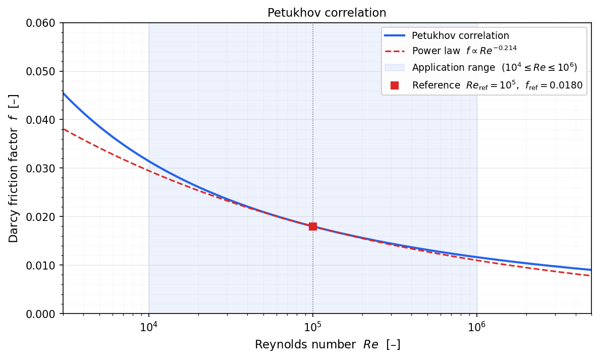

# Aerodynamics

## Turbulent friction

The pressure drop over a straight duct of length $L$ is described by the *Darcy–Weisbach equation*

$$
\Delta p = f\,\frac{L}{D_h}\,\frac{1}{2}\rho V^2,
$$

where $V$ is the mean flow velocity, $D_h$ the hydraulic diameter, and $f$ the dimensionless Darcy friction factor. For fully-developed turbulent flow in a smooth duct, $f$ depends only on the Reynolds number $Re = \rho V D_h / \mu$ through the *Petukhov correlation* ([White, 2016](/theory/references#white2016))

$$
f(Re) = \bigl(1.82\log_{10}Re - 1.64\bigr)^{-2},
$$

which is valid for $3\times10^3 \lesssim Re \lesssim 5\times10^6$.

The figure shows $f(Re)$ over the full validity range, with the application band for our wind-tunnel model shaded ($10^4 \leq Re \leq 10^6$). Within this band, the correlation is approximated by the power law

$$
f(Re) \approx f_\text{ref}\!\left(\frac{Re}{Re_\text{ref}}\right)^{-n},
$$

with $Re_\text{ref} = 10^5$, $f_\text{ref} = 0.01797$, and $n = 0.214$. The relative error remains below $\sim\!6\%$ over the application range.
