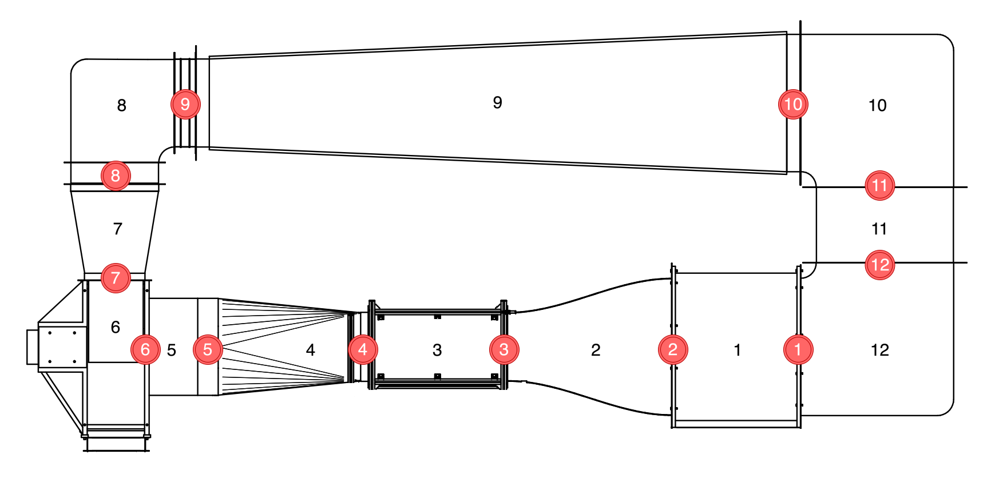

import Derivation from '@site/src/components/Derivation';

# Pressure Network Model

Although PROTOFLOW is a nearly closed circuit, real-world imperfections introduce small leaks between the tunnel interior and the surrounding atmosphere. Even though the resulting mass flows are small compared to the main circulation, they have a disproportionate effect: in a perfectly sealed circuit the absolute pressure distribution would be entirely indeterminate, whereas even minor leakage anchors the absolute level. Predicting where in the circuit the pressure sits relative to atmosphere matters for instrument calibration, model loading corrections, and flow quality assessment.

The pressure network model described here predicts the static pressure at each component interface and the volumetric flow rate through each component, for a given fan operating point and a set of component and leak parameters.

## Numbering convention

Components and nodes are numbered as shown in the schematic below, starting from the settling chamber and increasing in the flow direction (clockwise). Full component descriptions are given in [The Wind Tunnel](/windtunnel).

**Node $i$** is defined as the cross-section at the **inlet of component $i$**. The outlet of component $i$ coincides with node $i+1$. With twelve components the circuit closes: node 13 ≡ node 1.

| Symbol | Meaning |
|--------|---------|
| $p_i$ | Static pressure at node $i$ (Pa) |
| $Q_i$ | Volumetric flow rate through component $i$ (m³ s⁻¹) |
| $A_i$ | Cross-sectional area at node $i$ (m²) |
| $V_i = Q_i/A_i$ | Mean flow velocity at node $i$ (m s⁻¹) |
| $q_i = \tfrac{1}{2}\rho V_i^2$ | Dynamic pressure at node $i$ (Pa) |
| $K_i$ | Pressure-loss coefficient of component $i$ (–) |
| $k_i$ | Leak conductance at node $i$ (m³ s⁻¹ Pa⁻¹) |

The 24 unknowns $(p_1, \ldots, p_{12},\, Q_1, \ldots, Q_{12})$ are governed by two sets of 12 equations each.

## Pressure equations

Across each component the static pressure changes according to

$$
p_{i+1} - p_i =
\begin{cases}
  \Delta p_\text{fan}(Q_i) & i = 6 \\
  \alpha_i\, q_i           & \text{otherwise}
\end{cases}
$$

with $i = 1, \ldots, 12$ and $p_{13} \equiv p_1$. Component 6 is the centrifugal fan; its pressure rise $\Delta p_\text{fan}$ follows the manufacturer's characteristic curve as a function of the volume flow $Q_6$. For all other components the **pressure coefficient** $\alpha_i$ captures both the viscous loss and the conversion between dynamic and static pressure due to any change in cross-sectional area:

$$
\alpha_i = \underbrace{1 - \left(\frac{A_i}{A_{i+1}}\right)^{\!2}}_{\text{area change}} \;-\; \underbrace{K_i}_{\text{loss}}, \qquad i \neq 6
$$

where $K_i \geq 0$ is the (local) loss coefficient and $A_{i+1}$ is the outlet area of component $i$. For constant-area sections $A_i = A_{i+1}$, so the area term vanishes and $\alpha_i = -K_i < 0$ (pure pressure loss). For diffusers $A_{i+1} > A_i$ and the area term is positive; for well-designed diffusers this exceeds the loss, giving $\alpha_i > 0$ (net static pressure rise). For the contraction $A_{i+1} \ll A_i$ and $\alpha_i \ll 0$ (large static pressure drop as the flow accelerates).

<Derivation title="Derivation of the pressure coefficient α_i">

Apply the energy equation between node $i$ (inlet) and node $i+1$ (outlet) of component $i$.
Mechanical energy dissipated by viscous effects is quantified by the loss coefficient $K_i \geq 0$,
referenced to the inlet dynamic pressure $q_i$:

$$
p_{t,i+1} = p_{t,i} - K_i\, q_i
$$

where $p_{t,j} = p_j + \tfrac{1}{2}\rho(Q_i/A_j)^2$ is the total pressure at node $j$.
No mass escapes within a component, so the same volume flow $Q_i$ applies at inlet and outlet.
Expanding both total pressures:

$$
p_{i+1} + \tfrac{1}{2}\rho\frac{Q_i^2}{A_{i+1}^2}
= p_i + \tfrac{1}{2}\rho\frac{Q_i^2}{A_i^2} - K_i\, q_i
$$

Recognising $\tfrac{1}{2}\rho Q_i^2/A_j^2 = q_i(A_i/A_j)^2$ and rearranging:

$$
p_{i+1} - p_i = q_i\!\left[1 - \left(\frac{A_i}{A_{i+1}}\right)^{\!2} - K_i\right]
$$

Comparing with the defining relation $p_{i+1} - p_i = \alpha_i\, q_i$ yields the result.

</Derivation>

Summing all twelve pressure equations around the closed loop yields the **circuit balance**:

$$
\Delta p_\text{fan}(Q) = -\sum_{i \neq 6} \alpha_i\, q_i
$$

which determines the operating flow rate $Q$.

## Mass-balance equations

At each node, the volumetric flow rate changes by the amount that leaks through the duct wall. The leak is modelled as linearly proportional to the local gauge pressure, with conductance $k_i$:

$$
Q_i - Q_{i-1} = k_i\,(p_\text{atm} - p_i), \qquad i = 1, \ldots, 12
$$

with $Q_0 \equiv Q_{12}$. When $p_i < p_\text{atm}$ the right-hand side is positive (ambient air enters); when $p_i > p_\text{atm}$ it is negative (tunnel air escapes). Summing all twelve equations gives the **global leak balance**:

$$
\sum_{i=1}^{12} k_i\,(p_\text{atm} - p_i) = 0
$$

which implicitly determines the absolute pressure level of the circuit.

## Solution strategy

Because the leak flows are small compared to the main circulation ($Q_i \approx Q$ throughout), the system decouples naturally into two levels.

**Zeroth order — sealed circuit.** Set all $k_i = 0$. The twelve flow rates become equal ($Q_i = Q$) and the twelve pressure equations reduce to a rank-11 system for the pressure *differences*, closed by the circuit balance. This gives the operating point $Q$ and the complete pressure distribution up to an unknown additive constant $p_0$.

**First order — absolute level.** Writing $p_i = p_0 + \delta p_i$ where $\delta p_i$ are the differences from the zeroth-order solution, the global leak balance yields

$$
p_0 = p_\text{atm} - \frac{\displaystyle\sum_{i=1}^{12} k_i\,\delta p_i}{\displaystyle\sum_{i=1}^{12} k_i}
$$

The absolute static pressure at every node is then $p_i = p_0 + \delta p_i$. With a uniform leak distribution ($k_i = k$ for all $i$) this reduces to $p_0 = p_\text{atm} - \bar{\delta p}$: the pressure distribution is centred on atmospheric, irrespective of the individual loss coefficients.

## Component details

The pressure coefficient $\alpha_i$ for each component is determined by its geometry and the
loss coefficient $K_i$.  The subsections below present $K_i$ for each component, parameterised in
terms of measurable physical properties.

### Settling chamber (component 1)

The settling chamber is the largest, lowest-velocity section of the circuit (1000×1000 mm cross-section, $V_1 = V_\text{ts}/4$).  It contains a **honeycomb**—a bundle of long, thin cells that align the flow with the tunnel axis—followed by one or more **screens** that break up large-scale turbulence into small eddies which decay rapidly downstream.  Because $A_1 = A_2$, the pressure coefficient reduces to $\alpha_1 = -K_1$.

The honeycomb and screen losses are additive:

$$
K_1 = K_\text{hc} + \sum_{j=1}^{n_\text{sc}} K_{\text{sc},j}.
$$

**Honeycomb.** Flow inside the narrow cells is laminar (Hagen–Poiseuille):

$$
K_\text{hc} = \frac{C_\text{hc}\,\nu\,L_\text{hc}}{V_1\,d_\text{hc}^2}.
$$

Note that $K_\text{hc} \propto 1/V_1$, so the honeycomb resistance is velocity-dependent.

**Screens.** Each screen has porosity $\beta_j = (1 - d_{\text{sc},j}/M_{\text{sc},j})^2$ and a Borda–Carnot mixing loss:

$$
K_{\text{sc},j} = \left(\frac{1 - \beta_j}{\beta_j}\right)^{\!2}.
$$

At settling-chamber velocities ($Re_{d_\text{sc}} \approx 60$–$150$) viscous effects reduce this value and a Reynolds-number correction should be applied.

| Parameter | Symbol | Value | Unit |
|-----------|--------|-------|------|
| Cell hydraulic diameter | $d_\text{hc}$ | t.b.d. | mm |
| Cell length | $L_\text{hc}$ | t.b.d. | mm |
| Shape factor | $C_\text{hc}$ | 57 (hexagonal) | — |
| Number of screens | $n_\text{sc}$ | t.b.d. | — |
| Wire diameter | $d_{\text{sc},j}$ | t.b.d. | mm |
| Mesh spacing | $M_{\text{sc},j}$ | t.b.d. | mm |

<Derivation title="Derivation — settling chamber loss coefficients">

**Honeycomb.** Laminar Darcy–Weisbach with $f = C_\text{hc}/Re_{d_\text{hc}}$:

$$
\Delta p_\text{hc}
  = f\frac{L_\text{hc}}{d_\text{hc}}\,q_1
  = \frac{C_\text{hc}}{Re_{d_\text{hc}}}\cdot\frac{L_\text{hc}}{d_\text{hc}}\,q_1
  = \underbrace{\frac{C_\text{hc}\,\nu\,L_\text{hc}}{V_1\,d_\text{hc}^2}}_{K_\text{hc}}\!q_1.
$$

**Screens.** The open-area fraction $\beta_j$ accelerates the flow to $V_1/\beta_j$ at the screen plane.  Downstream the jets mix irreversibly back to $V_1$; the Borda–Carnot pressure loss is:

$$
\Delta p_{\text{sc},j}
  = \tfrac{1}{2}\rho\!\left(\frac{V_1}{\beta_j} - V_1\right)^{\!2}
  = q_1\!\left(\frac{1-\beta_j}{\beta_j}\right)^{\!2}.
$$

This derivation assumes that all kinetic energy in the accelerated jets is dissipated irreversibly, which is the high-$Re_{d_\text{sc}}$ limit.

</Derivation>
