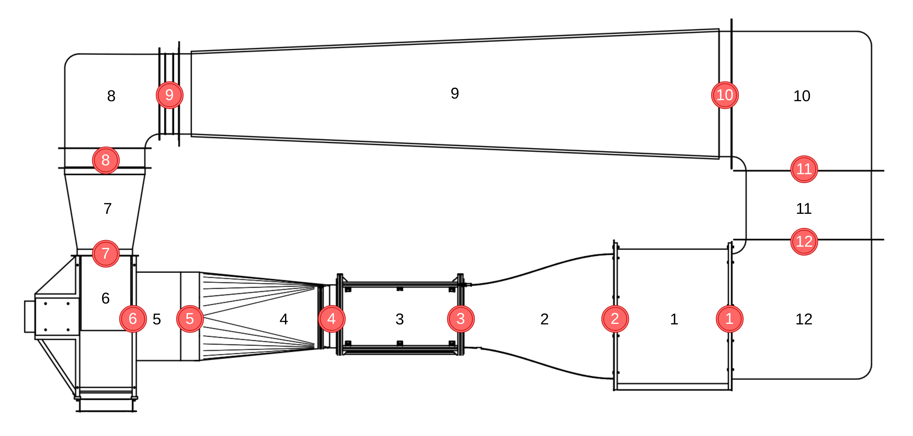
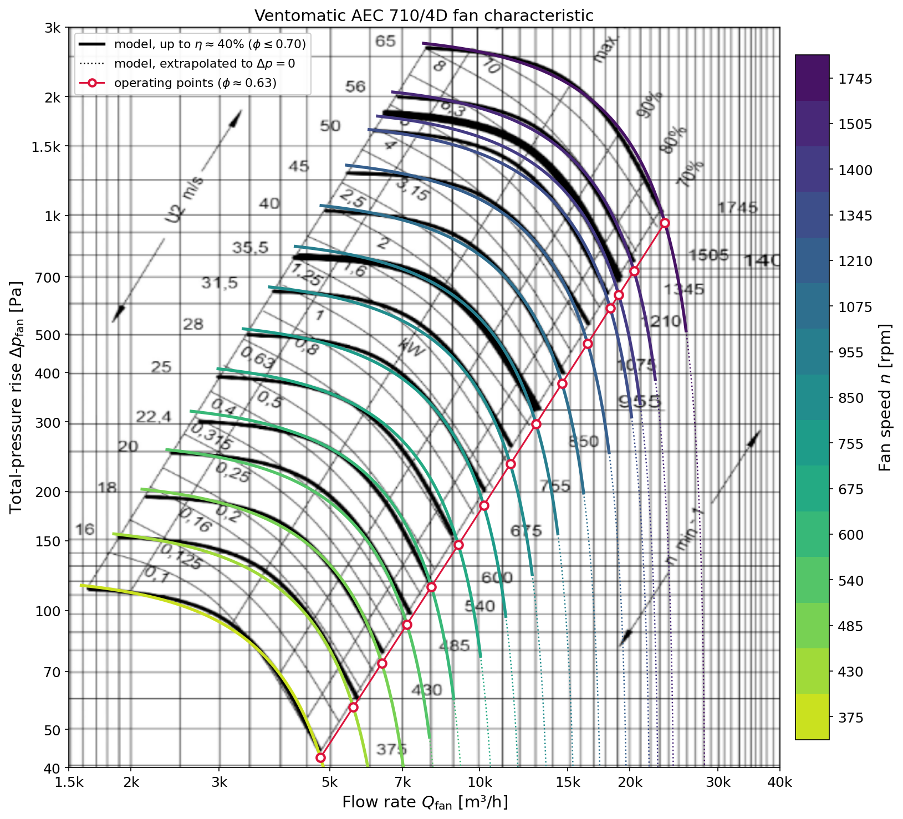

import Derivation from '@site/src/components/Derivation';

# Wind tunnel model

A one-dimensional flow model is developed to predict the flow rates in the various sections of the wind tunnel. In this one-dimensional model, the flow is characterized by the volumetric flow rates, $Q_i$, in each section and the static pressure at each section interface, $p_i$ (red nodes). Pressures and velocities represent spatial means over the cross-section area. Non-uniformities such as boundary layers, velocity deficits, and secondary flows are not resolved individually [(Barlow et al., 1999)](/theory/references#barlow1999).

| Symbol | Meaning |
|--------|---------|
| $A_i$ | Cross-sectional area at node $i$ (m²) |
| $p_i$ | Static pressure at node $i$ (Pa) |
| $Q_i$ | Volumetric flow rate through section $i$ (m³ s⁻¹) |
| $V_i = Q_i/A_i$ | Mean flow velocity at node $i$ (m s⁻¹) |
| $q_i = \tfrac{1}{2}\rho V_i^2$ | Dynamic pressure at node $i$ (Pa) |
| $K_i$ | Pressure-loss coefficient of section $i$ (–) |
| $\Lambda_i$ | Leakage coefficient of section $i$ (–) |

## Pressure equations

The centrifugal fan is the only active element in the circuit. Its rotational speed $n$ is the primary control variable for setting the wind-tunnel operating condition. At a given speed the fan delivers a pressure rise, $\Delta p_\text{fan} \equiv p_7 - p_6$, that depends on the volume flow, $Q_\text{fan} \equiv Q_6$, through its characteristic curve

$$
\Delta p_\text{fan} = \Delta p_\text{fan}(Q_\text{fan}, n).
$$

For all other sections ($i \neq 6$), Bernoulli's equation with an irreversible loss gives

$$
p_{i+1} - p_{i}  =  q_i - q_{i+1} - K_i\,q_i,
$$

where $K_i \geq 0$ is the dimensionless loss coefficient of section $i$ [(Barlow et al., 1999)](/theory/references#barlow1999).

Summing the pressure equations around the closed loop, the circuit balance equation is obtained as

$$
\Delta p_\text{fan}(Q_\text{fan},n) = \sum_{i \neq 6} K_i\,q_i,
$$

where it is assumed that the dynamic pressure does not change over the fan ($q_6 = q_7$). This assumption is justified by the practically identical inflow and outflow areas of this section, as well as its negligible leakage. The circuit balance conveys that the intersection of the fan characteristic with the circuit resistance curve determines the operating flow rate $Q_\text{fan}$ for a given fan speed $n$.

## Mass-balance equations

Although PROTOFLOW is a nearly closed circuit, imperfections introduce small leaks between the tunnel interior and the surrounding atmosphere. Even though the resulting mass flows are small compared to the main circulation, they have a disproportionate pressure effect. In a perfectly sealed circuit, the absolute pressure distribution would be entirely indeterminate, whereas even minor leakage anchors the absolute level.

For each passive section the leakage is modeled as

$$
\frac{Q_{i+1} - Q_i}{Q_i} = \Lambda_i\,\frac{p_\text{atm} - p_i}{q_i} \qquad i \neq 6,
$$

where $\Lambda_i$ is the dimensionless leakage coefficient. The right-hand side is positive (air enters) when $p_i < p_\text{atm}$ and negative (air escapes) when $p_i > p_\text{atm}$.

Summing all the leakage equations over the closed circuit gives the global mass balance

$$
\sum_{i=1}^{12} \Lambda_i\,Q_i\,\frac{p_\text{atm} - p_i}{q_i} = 0,
$$

which pins the absolute pressure level of the circuit.

## Model parameters

The pressure-network model is characterized by a set of dimensionless loss and leakage coefficients, $K_i$ and $\Lambda_i$, for each section. These parameters are tabulated below and detailed derivations are provided in the remainder of this section. Throughout, ISA sea-level air properties are assumed: $\rho=1.225\,\text{kg/m}^3$ and $\mu=1.789\times10^{-5}\,\text{Pa\,s}$.

| # | Component | Inlet area $A_i$ [$\text{mm}^2$] | Loss coefficient $K_i$ | Leakage coefficient $\Lambda_i$ [-] |
|:---:|:---|:---|:---|:---|
| 1 | Settling chamber | 1,000,000 | $1.50 + 0.85/Q_1 + 2.35\,Q_1^{-1/2}$ |   |
| 2 | Contraction | 1,000,000 | $0.80$ |   |
| 3 | Test section | 250,000 | $0.0336\,Q_3^{-0.214}$ | $6.1\times10^{-3}$ |
| 4 | Diffuser 1 | 250,000 | $0.02445\,Q_4^{-0.214} + 0.0307$ |   |
| 5 | Flexible sleeve | 395,900 | $0.44$ |   |
| 6 | Fan | 395,900 | $0.50 + 0.11/Q_6 + K_\text{se}$ (internal, see below) | 0  |
| 7 | Diffuser 2 | 393,300 | $0.01846\,Q_7^{-0.214} + 0.00683$ | $1.22\times10^{-3}$ |
| 8 | Corner 1 | 491,401 | $0.042$ | $6.1\times10^{-4}$ |
| 9 | Diffuser 3 | 491,401 | $0.05032\,Q_9^{-0.214} + 0.0342$ |   |
| 10 | Corner 2 | 1,000,000 | $0.042$ | $6.1\times10^{-4}$ |
| 11 | Vertical return duct | 1,000,000 | $0.00585\,Q_{11}^{-0.214}$ | $6.1\times10^{-4}$ |
| 12 | Corner 3 | 1,000,000 | $0.042$ | $6.1\times10^{-4}$ |

:::note

- In the table above all flow rates $Q_i$ are in $\text{m}^3/\text{s}$.
- The test-section coefficient $K_3$ corresponds to an empty test section ($K_\text{model} = 0$).
- The fan coefficient $K_6$ is an internal loss of the installed fan: it is subtracted from the catalogue pressure rise (see [Installed fan pressure rise](#installed-fan-pressure-rise)). The system-effect coefficient $K_\text{se} \approx 4.12$ is calibrated on measurements.

:::

### Centrifugal fan

The centrifugal fan (Ventomatic AEC 710/4D) is the energy source of the circuit.  It draws flow axially through the $\varnothing 710\,\text{mm}$ flexible-sleeve inlet and discharges it radially through a $900 \times 437\,\text{mm}$ rectangular outlet, thereby also performing the fourth $90^{\circ}$ turn of the closed loop without requiring a separate vaned corner. The cross-sectional area of the fan inlet ($A_6 = 395\,900\,\text{mm}^2$) and outlet ($A_7 = 393\,300\,\text{mm}^2$) are nearly identical, validating the dynamic pressure assumption $q_6 = q_7$.

The rated speed of the fan is $n_0=1400$ [rpm] and the performance diagram, evaluated at $\rho = 1.2\,\text{kg/m}^3$, is shown below. 

To evaluate the model, the catalogue fan pressure rise, $\Delta p_{\text{cat}}$, needs to be expressed as a function of the flow rate, $Q_{\text{fan}}$, and the the fan speed, $n$. Following [(Dixon and Hall, 2014)](/theory/references#dixon2014) this function can be expressed as

$$
\Delta p_\text{cat}(Q_\text{fan},n) = \rho\, n_\text{eff}^2 D_2^2\;
\psi\!\left(\frac{Q_\text{fan}}{n_\text{eff}\,D_2^3}\right),
$$

where $D_2$ is the impeller diameter and 

$$
n_\text{eff} = n\,\exp\!\left(a_1 L + a_2 L^2\right), \qquad L = \ln\frac{n}{n_0}
$$

is the effective fan speed [(ISO 5801:2017)](/theory/references#iso5801), which compensates for low speed viscous effects [(Casey, 1985)](/theory/references#casey1985) [(Strub et al., 1987)](/theory/references#strub1987). The parameters $a_1=-0.0261$ and $a_2=-0.0488$ have been fitted on the performance diagram.

The dimensionless pressure difference and flow rate
$$
\psi = \frac{\Delta p_\text{cat}}{\rho\, n^2 D_2^2}, \qquad \phi = \frac{Q_\text{fan}}{n\,D_2^3},
$$
are fitted to the manufacturer data at the physical speed $n$ using a quadratic polynomial
$$
\psi(\phi) = c_0 + c_1\phi + c_2\phi^2,
$$
with $c_0 = 5.682$, $c_1 = 1.022$ and $c_2 = -11.069$. The fitted model, drawn over the manufacturer's diagram, is shown in the fan performance diagram.

| Parameter | Symbol | Value |
|-----------|--------|-------|
| Impeller diameter | $D_2$ | $710\,\text{mm}$ |
| Rated speed | $n_0$ | $1400\,\text{rpm}$ |

:::caution Range of validity
The model curves in the performance diagram are extrapolated beyond the manufacturer data ($0.208 \le \phi \le 0.637$) to $\phi \approx 0.70$, where the total efficiency has dropped to about $40\,\%$. 
:::

#### Installed fan pressure rise

The catalogue characteristic $\Delta p_\text{cat}$ is measured by the manufacturer on a standardized test rig, with uniform, swirl-free inflow and a straight outlet duct. In PROTOFLOW, the fan is installed differently: it draws its flow directly from the flexible sleeve, and a screen is mounted at its outlet. The pressure rise that the installed fan actually delivers is therefore lower than the catalogue value. This is modeled as an internal loss of the fan section:

$$
\Delta p_\text{fan}(Q_\text{fan},n) = \Delta p_\text{cat}(Q_\text{fan},n) - K_6\,q_6,
\qquad
K_6 = K_{\text{sc},6} + K_\text{se},
$$

where $K_{\text{sc},6}$ is the loss coefficient of the outlet screen and $K_\text{se}$ the system-effect coefficient. Both are referenced to the dynamic pressure at the fan inlet, $q_6$ (with $q_6 = q_7$). Substituted in the circuit balance, the fan loss simply adds to the losses of the passive sections:

$$
\Delta p_\text{cat}(Q_\text{fan},n) = \sum_{i=1}^{12} K_i\,q_i.
$$

**Outlet screen.** The screen at the fan outlet is of the same type as the settling-chamber screens (gap size $w_\text{sc} = 1.5\,\text{mm}$, wire diameter $t_\text{sc} = 0.3\,\text{mm}$), and its loss coefficient follows from the same expression:

$$
K_{\text{sc},6} = K_{\text{Rn}}\,\sigma_\text{sc} + \left(\frac{\sigma_\text{sc}}{\beta_\text{sc}}\right)^{\!2},
\qquad
K_{\text{Rn}} \approx 1 + \frac{a_\text{sc}}{Re_{t_\text{sc}}},
$$

now with the wire Reynolds number $Re_{t_\text{sc}} = \rho V_6\,t_\text{sc}/\mu$ based on the fan velocity $V_6 = Q_6/A_6$. Since $A_6 \approx 0.4\,A_1$, the velocity at the outlet screen is about 2.5 times higher than in the settling chamber, and the dynamic pressure about 6.4 times higher. A single screen at this location therefore causes a larger pressure loss than the three settling-chamber screens together. The wire Reynolds number is correspondingly higher, $Re_{t_\text{sc}} \approx 150$–$350$; in this range the approximation of $K_\text{Rn}$ deviates by at most 2.5% from the exact expression, which changes $K_{\text{sc},6}$ by less than 1%. It is assumed that the screen is located upstream of pressure tap P7, so that its loss is part of the measured fan section.

**System effect.** A fan installed with non-ideal inlet or outlet conditions delivers less pressure than its catalogue characteristic; this deficit is known as the *system effect* ([AMCA 201, 2002](/theory/references#amca201)). It is expressed as a multiple of the fan dynamic pressure, which is the same scaling as a regular loss. For centrifugal fans, non-uniform inflow is the most important contribution. In PROTOFLOW, the flexible sleeve is located directly upstream of the fan inlet: the separated jet formed by the sleeve obstruction needs approximately 6–8 step heights to reattach, which is longer than the remaining length of the sleeve, so the fan receives a distorted inflow. The flanges around the fan cause additional small losses, estimated at $K \approx 0.1$–$0.25$ in total, which are included in $K_\text{se}$.

As no reliable correlation exists for this specific installation, $K_\text{se}$ is calibrated such that the model reproduces the measured test-section velocity. The calibrated value is large compared to typical system-effect factors of order 1–2, which indicates that it also absorbs other model uncertainties, for example a deformation of the flexible sleeve under suction or a deviation from the catalogue characteristic.

<Derivation title="Fan-section loss coefficient">

| Parameter | Symbol | Value | Unit |
|-----------|--------|-------|------|
| Fan inlet area | $A_6$ | 0.3959 | $\text{m}^2$ |
| Screen wire diameter | $t_\text{sc}$ | 0.3 | mm |
| Screen mesh gap size | $w_\text{sc}$ | 1.5 | mm |
| Low-Reynolds screen parameter | $a_\text{sc}$ | 19 | — |

With $\beta_\text{sc} = 25/36$ and $\sigma_\text{sc} = 11/36$ (see [Settling chamber](#settling-chamber)), and substituting $V_6 = Q_6/A_6$:

$$
K_{\text{sc},6} = \underbrace{\sigma_\text{sc} + \left(\frac{\sigma_\text{sc}}{\beta_\text{sc}}\right)^{\!2}}_{0.306\,+\,0.194\,=\,0.50}
+ \underbrace{\frac{a_\text{sc}\,\sigma_\text{sc}\,\mu\,A_6}{\rho\,t_\text{sc}}}_{0.11\,\text{m}^3/\text{s}}\,\frac{1}{Q_6},
$$

where

$$
\frac{a_\text{sc}\,\sigma_\text{sc}\,\mu\,A_6}{\rho\,t_\text{sc}}
= \frac{19 \times 0.306 \times 1.789\times10^{-5} \times 0.3959}{1.225 \times 3\times10^{-4}}
= 0.11\,\text{m}^3/\text{s}.
$$

At the measured operating point ($Q_6 \approx 5.3\,\text{m}^3/\text{s}$) this gives $K_{\text{sc},6} \approx 0.52$, a pressure loss of about $55\,\text{Pa}$.

**Calibration of $K_\text{se}$.** The measurement of 2026-11-17 at $n = 1400\,\text{rpm}$ gave a test-section velocity of $V_3 = 20.98\,\text{m/s}$ (pitot tube), at an electrical fan power of $7015\,\text{W}$. With all other coefficients as tabulated, the model reproduces this velocity for

$$
K_\text{se} = 4.12,
$$

at which point $Q_6 = 5.28\,\text{m}^3/\text{s}$, $\phi = 0.63$ and $\Delta p_\text{cat} = 623\,\text{Pa}$. With $q_6 \approx 105\,\text{Pa}$, the fan section thus loses $K_6\,q_6 \approx 4.6 \times 105 \approx 490\,\text{Pa}$ internally. The corresponding air power, $Q_6\,\Delta p_\text{cat} \approx 3.3\,\text{kW}$, implies a fan efficiency of about 47%, which is plausible for this operating point.

The calibration is sensitive to the measured velocity: the mean velocity derived from the contraction pressure drop, $V_3 \approx 20.4\,\text{m/s}$, gives $K_\text{se} = 5.2$.

</Derivation>

:::note Distinguishing inlet and outlet losses
The measured pressures at P5 and P7 cannot distinguish a loss upstream of the fan (in the flexible sleeve) from a fan pressure deficit. Both give the same pressures at all current taps, but differ at the fan inlet: approximately $-670\,\text{Pa}$ for a sleeve loss versus $-190\,\text{Pa}$ for a fan deficit. A pressure tap at the fan inlet (node 6) would resolve this.
:::

### Settling chamber

The settling chamber (section 1), which has a $1000\times1000\,\text{mm}$ square cross-section, contains two flow-conditioning elements in series: a honeycomb structure that straightens and de-swirls the approach flow, followed by $n_{\text{sc}}=3$ screens that break up large-scale turbulence into fine eddies that decay rapidly in the downstream contraction ([Barlow et al., 1999](/theory/references#barlow1999)).

The total pressure-loss coefficient is the sum of the individual honeycomb and screen contributions:

$$
K_1 = K_\text{hc} + \sum_{j=1}^{n_\text{sc}} K_{\text{sc},j}.
$$

**Honeycomb.** The flow inside the narrow cells is laminar, with cell Reynolds number $Re_{d_\text{hc}} = \rho V_1 d_\text{hc}/\mu$, where $d_\text{hc}$ is the hydraulic diameter of the cells (the diameter of the inscribed circle). The laminar entrance length, $L_\text{e} \approx 0.05\,Re_{d_\text{hc}}\,d_\text{hc}$ ([White, 2016](/theory/references#white2016)), is much larger than the cell length $L_\text{hc}$, so the velocity profile never becomes fully developed. The fully developed Hagen–Poiseuille friction factor therefore underestimates the loss: near the cell entrance the boundary layers are thin and the wall shear stress is high. In this short-duct limit, the apparent Darcy friction factor follows from the correlation of [Shah (1978)](/theory/references#shah1978):

$$
f_\text{app}\,Re_{d_\text{hc}} \approx \frac{C_\text{hc}}{\sqrt{x^+}},
\qquad
x^+ = \frac{L_\text{hc}}{d_\text{hc}\,Re_{d_\text{hc}}},
$$

with $C_\text{hc} = 4 \times 3.44 = 13.76$. The honeycomb loss coefficient $K_\text{hc} = f_\text{app}\,L_\text{hc}/d_\text{hc}$ then becomes

$$
K_\text{hc} = C_\text{hc}\,\sqrt{\frac{L_\text{hc}}{d_\text{hc}}}\;Re_{d_\text{hc}}^{-1/2}.
$$

The thickness of the cell walls is neglected, so the velocity inside the cells is taken equal to $V_1$ and the entry and exit losses of the cells are omitted.

**Screens.** Each screen is a woven square mesh with mesh gap size $w_{\text{sc},j}$ and wire thickness $t_{\text{sc},j}$. Since the wires run in two directions, its open-area ratio and solidity are

$$
\beta_{\text{sc},j} = \left(\frac{w_{\text{sc},j}}{w_{\text{sc},j} + t_{\text{sc},j}}\right)^{\!2},
\qquad
\sigma_{\text{sc},j} = 1 - \beta_{\text{sc},j}.
$$

The pressure loss over a screen consists of a drag contribution of the wires, proportional to the solidity, and a Borda–Carnot mixing loss of the jets emerging from the mesh openings ([Barlow et al., 1999](/theory/references#barlow1999); [Pinker & Herbert, 1967](/theory/references#pinker1967)):

$$
K_{\text{sc},j} = K_{\text{Rn}}\,\sigma_{\text{sc},j} + \left(\frac{\sigma_{\text{sc},j}}{\beta_{\text{sc},j}}\right)^{\!2}.
$$

The factor $K_{\text{Rn}}$ accounts for viscous effects at low wire Reynolds number $Re_{t_{\text{sc},j}} = \rho V_1\,t_{\text{sc},j}/\mu$:

$$
K_{\text{Rn}} = 0.785\left(1 + \frac{Re_{t_{\text{sc},j}}}{241}\right)^{\!-4} + 1.01
\;\approx\; 1 + \frac{a_\text{sc}}{Re_{t_{\text{sc},j}}},
$$

where the approximation with $a_\text{sc} = 19$ is accurate to within 1% over $Re_{t_{\text{sc},j}} = 40$–$150$, the range covered by the PROTOFLOW operating envelope.

<Derivation title="Settling chamber loss coefficient">

| Parameter | Symbol | Value | Unit |
|-----------|--------|-------|------|
| Cell length | $L_\text{hc}$ | 50 | mm |
| Cell inscribed diameter | $d_\text{hc}$ | 5 | mm |
| Developing-flow constant | $C_\text{hc}$ | 13.76 | — |
| Number of screens | $n_\text{sc}$ | 3 | — |
| Screen wire diameter | $t_\text{sc}$ | 0.3 | mm |
| Screen mesh gap size | $w_\text{sc}$ | 1.5 | mm |
| Low-Reynolds screen parameter | $a_\text{sc}$ | 19 | — |

Substituting $V_1 = Q_1/A_1$ with $A_1 = 1\,\text{m}^2$ and grouping by power of $Q_1$:

$$
K_1 = \underbrace{n_\text{sc}\!\left[\sigma_\text{sc} + \left(\frac{\sigma_\text{sc}}{\beta_\text{sc}}\right)^{\!2}\right]}_{\text{inertial screens}}
      + \underbrace{\frac{n_\text{sc}\,a_\text{sc}\,\sigma_\text{sc}\,\mu\,A_1}{\rho\,t_\text{sc}}}_{\text{viscous screens}}\,\frac{1}{Q_1}
      + \underbrace{\frac{C_\text{hc}}{d_\text{hc}}\sqrt{\frac{\mu\,L_\text{hc}\,A_1}{\rho}}}_{\text{honeycomb}}\,\frac{1}{\sqrt{Q_1}}.
$$

Evaluating each term:

$$
\beta_\text{sc} = \left(\frac{1.5}{1.5+0.3}\right)^{\!2} = \frac{25}{36},
\qquad
\sigma_\text{sc} = \frac{11}{36},
\qquad
\left(\frac{\sigma_\text{sc}}{\beta_\text{sc}}\right)^{\!2} = \left(\frac{11}{25}\right)^{\!2} = 0.194,
$$

$$
n_\text{sc}\!\left[\sigma_\text{sc} + \left(\frac{\sigma_\text{sc}}{\beta_\text{sc}}\right)^{\!2}\right]
= 3 \times (0.306 + 0.194) = 1.50,
$$

$$
\frac{n_\text{sc}\,a_\text{sc}\,\sigma_\text{sc}\,\mu\,A_1}{\rho\,t_\text{sc}}
= \frac{3 \times 19 \times 0.306 \times 1.789\times10^{-5} \times 1}{1.225 \times 3\times10^{-4}}
= 0.85\,\text{m}^3/\text{s},
$$

$$
\frac{C_\text{hc}}{d_\text{hc}}\sqrt{\frac{\mu\,L_\text{hc}\,A_1}{\rho}}
= \frac{13.76}{5\times10^{-3}}\sqrt{\frac{1.789\times10^{-5} \times 0.050 \times 1}{1.225}}
= 2.35\,\text{m}^{3/2}/\text{s}^{1/2}.
$$

This gives

$$
K_1 = 1.50 + \frac{0.85}{Q_1} + \frac{2.35}{\sqrt{Q_1}},
$$

with $Q_1$ in $\text{m}^3/\text{s}$. At $Q_1 = 5\,\text{m}^3/\text{s}$ the screens contribute $K_\text{sc} \approx 1.67$ and the honeycomb $K_\text{hc} \approx 1.05$.

Over $Q_1 = 2$–$7\,\text{m}^3/\text{s}$, this expression is within 6% of the result obtained with the full developing-flow correlation of [Shah (1978)](/theory/references#shah1978) and the exact $K_\text{Rn}$. The short-duct approximation for the honeycomb slightly underestimates the extra pressure drop at the cell entrance.

</Derivation>

### Contraction

The contraction (section 2) is a fixed, pre-existing component that smoothly converges the $1000\times1000\,\text{mm}$ settling-chamber outlet to the $500\times500\,\text{mm}$ test-section inlet, giving an area ratio $A_2/A_3 = 4$. 

For a smooth, well-designed contraction the pressure loss coefficient relative to the test-section dynamic pressure is typically $\zeta_2 = 0.04$–$0.06$ ([Barlow et al., 1999](/theory/references#barlow1999); [Mehta & Bradshaw, 1979](/theory/references#mehta1979)). Referenced to the inlet dynamic pressure $q_2$, the loss coefficient reads

$$
K_2 = \zeta_2 \left(\frac{A_2}{A_3}\right)^{\!2}.
$$

<Derivation title="Contraction loss coefficient">

| Parameter | Symbol | Value | Unit |
|-----------|--------|-------|------|
| Area ratio | $A_2/A_3$ | 4 | — |
| Loss coefficient (ref. $q_3$) | $\zeta_2$ | 0.04–0.06 | — |

Taking the midpoint $\zeta_2 = 0.05$ as the nominal value:

$$
K_2 = \zeta_2\!\left(\frac{A_2}{A_3}\right)^{\!2} = 0.05 \times 4^2 = 0.80.
$$

</Derivation>

### Test section

The test section (section 3) has a constant square cross-section of $500\times500\,\text{mm}$ over a length of $L = 1000\,\text{mm}$.  The total loss coefficient has two additive contributions:

$$
K_3 = K_{\text{wall}} + K_\text{model}.
$$

The first term represents pressure losses due to boundary layers along all four walls. For turbulent flow in a smooth-walled duct, Darcy–Weisbach ([White, 2016](/theory/references#white2016)) yields

$$
K_\text{wall} = f(Re_{W_3})\,\frac{L_3}{W_3},
$$

where $W_3$ is the duct width (equal to the hydraulic diameter for a square duct) and $f$ is the Darcy friction factor evaluated at $Re_{W_3} = \rho V_3 W_3/\mu$ using the [Petukhov correlation](/theory/aerodynamics#turbulent-friction).

An aerodynamic specimen placed in the test section exerts a drag force $F_D = C_D\,q_3\,A_\text{model}$ on the flow. A horizontal momentum balance on the control volume of the test section equates this drag force to the resulting pressure drop over the duct cross-section, giving the specimen loss coefficient 

$$
K_\text{model} = \frac{F_D}{q_3\,A_3} = C_D \frac{A_\text{model}}{A_3},
$$

where $C_D$ is the drag coefficient and $A_\text{model}$ the reference area of the specimen.

For an empty test section $K_\text{model} = 0$, such that $K_3 = K_\text{wall}$.

<Derivation title="Test-section wall loss coefficient">

| Parameter | Symbol | Value | Unit |
|-----------|--------|-------|------|
| Length | $L_3$ | 1,000 | mm |
| Width | $W_3$ | 500 | mm |

The geometric factor is $L_3/W_3 = 2$. With $V_3 = Q_3/A_3$ and $A_3 = 0.25\,\text{m}^2$, the Reynolds number becomes

$$
Re_{W_3} = \frac{\rho\,W_3}{\mu\,A_3}\,Q_3
= \frac{1.225 \times 0.5}{1.789\times10^{-5} \times 0.25}\,Q_3
= 1.370\times10^5\,Q_3,
$$

covering $6.9\times10^4 \leq Re_{W_3} \leq 6.9\times10^5$ over the operating range ($V_3 = 2$–$20\,\text{m/s}$). Substituting the [power-law approximation](/theory/aerodynamics#turbulent-friction) $f \approx 0.01797\,(Re_{W_3}/10^5)^{-0.214}$:

$$
K_\text{wall} = f(Re_{W_3})\,\frac{L_3}{W_3}
\approx 0.01797 \times (1.370\times10^5\,Q_3\,/\,10^5)^{-0.214} \times 2,
$$

$$
K_\text{wall} \approx 0.0336\,Q_3^{-0.214}.
$$

</Derivation>

### Diffusers

The three diffusers (sections 4, 7 and 9) recover static pressure by decelerating the flow. The loss coefficient is decomposed into a skin-friction contribution and an expansion contribution [(Barlow, 1999)](/theory/references#barlow1999):

$$
K_i = K_f + K_{ex}.
$$

Both contributions can be expressed in terms of the diffuser area ratio $A_{i+1}/A_i$ and half-angle $\theta_i = \arctan\!\left(\frac{W_{i+1} - W_i}{2\,L_i}\right)$, where $L_i$ is the diffuser length and $W_i = \sqrt{A_i}$ is the (equivalent) width (side length for a square cross-section).

The friction loss coefficient reads

$$
K_f = \left(1 - \frac{A_i^2}{A_{i+1}^2}\right)\frac{f(Re_{W_i})}{8\sin\theta_i}, 
$$

where $f(Re_{W_i})$ is the [Darcy friction factor](/theory/aerodynamics#turbulent-friction) evaluated at the diffuser-inlet Reynolds number $Re_{W_i} = \rho V_i W_i/\mu$.

The expansion loss coefficient is given by

$$
K_{ex} = K_e(\theta_i)\left(\frac{A_{i+1} - A_i}{A_{i+1}}\right)^{\!2},
$$

where $K_e(\theta_i)$ is a shape factor that depends on the half-angle. All three diffusers are modeled with square cross-sections with equivalent width $W_i$, and fall within the range $1.5° < \theta_i < 5°$. From [Barlow et al. (1999)](/theory/references#barlow1999) it then follows that

$$
\begin{aligned}
K_e &= 0.1222 - 0.04590\,\theta_i + 0.02203\,\theta_i^2 + 0.003269\,\theta_i^3 \\
&\quad {}- 0.0006145\,\theta_i^4 - 0.00002800\,\theta_i^5 + 0.00002337\,\theta_i^6,
\end{aligned}
$$

with $\theta_i$ in degrees. The operating point of each diffuser falls inside the "no appreciable stall" zone of the [Reneau et al. (1967)](/theory/references#reneau1967) regime map, confirming that the attached-flow assumption underlying the loss model is valid.

<Derivation title="Diffuser loss coefficients">

The geometric parameters of the three diffusers are listed below:

| Parameter | Section 4 | Section 7 | Section 9 |
|:----------|:---------:|:---------:|:---------:|
| Equivalent inlet width $W_i$ [mm] | 500 | 627 | 701 |
| Equivalent outlet width $W_{i+1}$ [mm] | 629 | 701 | 1,000 |
| Length $L_i$ [mm] | 1,250 | 860 | 4,400 |
| Area ratio $A_{i+1}/A_i$ | 1.58 | 1.25 | 2.04 |
| Half-angle $\theta_i$ [°] | 2.96 | 2.46 | 1.95 |

The inlet Reynolds number $Re_{W_i} = \rho Q_i/(W_i\,\mu)$ is proportional to the section flow rate $Q_i$ with section-dependent prefactor $\rho/(W_i\mu)$. Substituting the [power-law approximation](/theory/aerodynamics#turbulent-friction) $f \approx f_\text{ref}(Re_{W_i}/Re_\text{ref})^{-n}$ into $K_f$ and factoring out $Q_i$:

$$
K_f = \left(1-\frac{A_i^2}{A_{i+1}^2}\right)\frac{f_\text{ref}}{8\sin\theta_i}\!\left(\frac{\rho}{W_i\,\mu\,Re_\text{ref}}\right)^{\!-n}\,Q_i^{-n}.
$$

Evaluating each coefficient from the geometric parameters and the $K_e$ polynomial:

| | Section 4 | Section 7 | Section 9 |
|:---|:---:|:---:|:---:|
| $1 - A_i^2/A_{i+1}^2$ | 0.601 | 0.359 | 0.759 |
| $f_\text{ref}/(8\sin\theta_i)$ | 0.0435 | 0.0523 | 0.0660 |
| $(\rho/(W_i\mu\,Re_\text{ref}))^{-n}$ | 0.935 | 0.981 | 1.005 |
| $\rho/(W_i\mu)$ [$\text{s/m}^3$] | $1.370\times10^5$ | $1.092\times10^5$ | $9.77\times10^4$ |
| $K_e(\theta_i)$ | 0.226 | 0.171 | 0.132 |
| $K_{ex,i}$ | 0.0307 | 0.00683 | 0.0342 |
| $K_i$ | $0.02445\,Q_4^{-0.214} + 0.0307$ | $0.01846\,Q_7^{-0.214} + 0.00683$ | $0.05032\,Q_9^{-0.214} + 0.0342$ |

</Derivation>

### Flexible sleeve

The flexible sleeve (section 5) is a short $\varnothing 710\,\text{mm}$ circular duct of total length $L_5 = 300\,\text{mm}$.  The fabric sleeve forms a local obstruction, reducing the clear diameter to approximately $D_\text{narrow} = 600\,\text{mm}$ over a central span of $L_\text{obs} \approx 100\,\text{mm}$.

The blockage is characterised by the area ratio $\beta = A_\text{narrow}/A_5 = (D_\text{narrow}/D_5)^2$.  The loss coefficient is written as

$$
K_5 = K_\text{cont} + K_\text{exp}.
$$

The sharp-edged contraction loss ([Idelchik, 1994, Diagr. 5-23](/theory/references#idelchik1994)) is

$$
K_\text{cont} = \frac{(1-\beta)}{2\beta^2},
$$

and the Borda–Carnot sudden expansion ([Idelchik, 1994, Diagr. 5-1](/theory/references#idelchik1994)) gives

$$
K_\text{exp} = \frac{(1-\beta)^2}{\beta^2}.
$$

Duct-wall friction is small compared to the obstruction loss and is neglected.

<Derivation title="Flexible-sleeve loss coefficient">

| Parameter | Symbol | Value | Unit |
|-----------|--------|-------|------|
| Inner diameter | $D_5$ | 710 | mm |
| Obstruction diameter | $D_\text{narrow}$ | $\approx$ 600 | mm |
| Total sleeve length | $L_5$ | 300 | mm |
| Obstruction span | $L_\text{obs}$ | $\approx$ 100 | mm |

Substituting the geometric values:

$$
\beta = \left(\frac{D_\text{narrow}}{D_5}\right)^{\!2} = \left(\frac{600}{710}\right)^{\!2} = 0.714,
$$

$$
K_\text{cont} = \frac{0.5\,(1-0.714)}{0.714^2} = \frac{0.143}{0.510} = 0.28,
\qquad
K_\text{exp}  = \frac{(1-0.714)^2}{0.714^2} = \frac{0.082}{0.510} = 0.16,
$$

so that

$$
K_5 = 0.28 + 0.16 = 0.44.
$$

</Derivation>

### Vaned corners

The three 90° vaned corners (sections 8, 10 and 12) redirect the flow using an array of $N_i$ turning vanes with the *SA070.61 profile* [(Sahlin & Johansson, 1991)](/theory/references#sahlin1991), chord $c = 162.6\,\text{mm}$.

Each vane exerts a drag force $F_v = C_D\,q_i\,c\,W_i$ on the flow proportional to the upstream dynamic pressure $q_i$, where $W_i$ is the duct width. Wall friction is neglected. Summing over all $N_i$ vanes and dividing by the cross-sectional area $A_i = W_i^2$ gives the pressure drop coefficient

$$
K_i = \frac{N_i\,F_v}{q_i\,A_i} = N_i\,C_D\,\frac{c}{W_i}.
$$

We adopt $C_D = 0.02$, the mid-range of $0.015$–$0.022$ reported by [Sahlin & Johansson (1991)](/theory/references#sahlin1991) for $\text{Re}_c \sim 10^4$–$10^5$.

<Derivation title="Vaned-corner loss coefficients">

Shared vane parameters:

| Parameter | Symbol | Value | Unit |
|-----------|--------|-------|------|
| Vane chord | $c$ | 162.6 | mm |
| Vane drag coefficient | $C_D$ | 0.02 | — |

Corner geometry and vane counts as specified in the tunnel design:

| Parameter | Section 8 | Section 10 | Section 12 |
|:----------|:---------:|:----------:|:----------:|
| Duct width $W_i$ [mm] | 701 | 1000 | 1000 |
| Vane count $N_i$ | 9 | 13 | 13 |

Substituting into $K_i = N_i\,C_D\,c/W_i$:

| | Section 8 | Section 10 | Section 12 |
|:---|:---:|:---:|:---:|
| $N_i\,c/W_i$ | $9 \times 162.6/701 = 2.09$ | $13 \times 162.6/1000 = 2.11$ | $13 \times 162.6/1000 = 2.11$ |
| $K_i = 0.02 \times N_i\,c/W_i$ | $0.0418$ | $0.0422$ | $0.0422$ |

</Derivation>

### Vertical return duct

The vertical return duct (section 11) is a constant-area $1000 \times 1000\,\text{mm}$ square section of length $L_{11} = 300\,\text{mm}$ connecting Corner 2 to Corner 3. Its loss follows the Darcy–Weisbach relation

$$
K_{11} = f_{11}\,\frac{L_{11}}{W_{11}},
$$

where $W_{11} = 1000\,\text{mm}$ is the hydraulic diameter of the square cross-section. The friction factor $f_{11}$ is evaluated at the local Reynolds number using the [power-law approximation for turbulent pipe flow](/theory/aerodynamics#turbulent-friction).

<Derivation title="Return-duct loss coefficient">

| Parameter | Symbol | Value | Unit |
|-----------|--------|-------|------|
| Duct length | $L_{11}$ | 300 | mm |
| Duct width / hydraulic diameter | $W_{11}$ | 1000 | mm |
| Cross-sectional area | $A_{11}$ | 1,000,000 | mm² |

For a square duct the hydraulic diameter equals the side length: $D_h = 4A_{11}/P = W_{11}$. With $V_{11} = Q_{11}/A_{11}$ and $A_{11} = 1\,\text{m}^2$, the Reynolds number is

$$
Re_{W_{11}} = \frac{\rho\,W_{11}}{\mu\,A_{11}}\,Q_{11}
= \frac{1.225 \times 1.000}{1.789\times10^{-5} \times 1}\,Q_{11}
= 6.847\times10^4\,Q_{11}.
$$

Substituting the [power-law approximation](/theory/aerodynamics#turbulent-friction) $f \approx 0.01797\,(Re_{W_{11}}/10^5)^{-0.214}$:

$$
K_{11} = 0.01797\,(6.847\times10^4\,Q_{11}/10^5)^{-0.214}\,\frac{0.300}{1.000}
\approx 0.00585\,Q_{11}^{-0.214},
$$

with $Q_{11}$ in $\text{m}^3/\text{s}$.

</Derivation>

### Leakage coefficients

Leakage through a gap or joint is modeled as orifice flow driven by the local gauge pressure $\Delta p_i = p_\text{atm} - p_i$,

$$
Q_{g,i} = C_d\,G_i\,\sqrt{\frac{2\,\Delta p_i}{\rho}},
$$

where $G_i$ is the effective gap area, $C_d \approx 0.61$ the discharge coefficient for a sharp-edged orifice.

For the pressure network model a linear leakage law of the form $Q_{g,i} = k_i\,\Delta p_i$ is required. Because there is no leakage at zero gauge pressure, a proportional model through the origin is physically consistent. The coefficient $k_i$ is chosen so that the linear model reproduces the orifice flow at the nominal operating pressure $\Delta p_i = q_i = \tfrac{1}{2}\rho V_i^2$:

$$
k_i = \frac{Q_{g,i}(q_i)}{q_i} = \frac{C_d\,G_i\,\sqrt{2\,q_i/\rho}}{q_i} = \frac{C_d\,G_i}{\sqrt{\tfrac{1}{2}\rho\,q_i}} = \frac{2\,C_d\,G_i}{\rho\,V_i},
$$

where the last step uses $q_i = \tfrac{1}{2}\rho V_i^2$. Defining the dimensionless leakage coefficient $\Lambda_i = k_i\,q_i/Q_i$ and writing $Q_i = V_i\,A_i$:

$$
\Lambda_i = \frac{2\,C_d\,G_i}{\rho\,V_i}\cdot\frac{\tfrac{1}{2}\rho\,V_i^2}{V_i\,A_i} = C_d \frac{G_i}{A_i}.
$$

The dimensionless leakage coefficient thus equals $C_d$ times the effective gap-area fraction, independent of the operating condition.

<Derivation title="Leakage coefficients">

With $C_d = 0.61$, the formula $\Lambda_i = C_d\,G_i/A_i$ gives $\Lambda_i = 0.61\,(G_i/A_i)$. The effective gap-area fractions are estimated from the mechanical design; components that are sealed or whose leakage is negligible are assigned $\Lambda_i = 0$.

| # | Component | $G_i/A_i$ [%] | $\Lambda_i$ |
|:---:|:---|:---:|:---:|
| 1 | Settling chamber | 0 | 0 |
| 2 | Contraction | 0 | 0 |
| 3 | Test section | 1.0 | $6.1 \times 10^{-3}$ |
| 4 | Diffuser 1 | 0 | 0 |
| 5 | Flexible sleeve | 0 | 0 |
| 6 | Fan | 0 | 0 |
| 7 | Diffuser 2 | 0.2 | $1.22 \times 10^{-3}$ |
| 8 | Corner 1 | 0.1 | $6.1 \times 10^{-4}$ |
| 9 | Diffuser 3 | 0 | 0 |
| 10 | Corner 2 | 0.1 | $6.1 \times 10^{-4}$ |
| 11 | Vertical return duct | 0.1 | $6.1 \times 10^{-4}$ |
| 12 | Corner 3 | 0.1 | $6.1 \times 10^{-4}$ |

The test section accounts for the largest leakage fraction: its specimen access panels and the gap around the model support introduce a gap-area fraction of 1%. Diffuser 2 sits directly above the fan housing and is assigned 0.2% to reflect the mechanical joint there. The three vaned corners and the vertical return duct each receive 0.1% for their bolted flanges.

</Derivation>

## Solution algorithm

The pressures and flow rates are determined by a fixed-point iteration. Each iteration consists of three steps.

**Step 1 — Flow-rate distribution.** Treat the gauge pressures $\Delta p_i = p_\text{atm} - p_i$ as known, assuming $\Delta p_i = 0$ for all $i$ for the first iteration. The flow rates can then be expressed as a function of $Q_\text{fan}$:
$$
Q_i = \begin{cases}
 Q_\text{fan} + \sum_{j=7}^{12} \Lambda_j Q_j \frac{\Delta p_j}{q_j} + \sum_{j=1}^{i-1} \Lambda_j Q_j \frac{\Delta p_j}{q_j} & i = 1, \ldots, 5\\
 Q_\text{fan} & i=6,7 \\
 Q_\text{fan} + \sum_{j=7}^{i-1} \Lambda_j Q_j \frac{\Delta p_j}{q_j} & i = 8, \ldots, 12
\end{cases}
$$
These flow rates can be evaluated by following the flow direction starting from the fan, and using $q_i = \rho Q_i^2/(2A_i^2)$.

**Step 2 — Fan operating point.** With all $Q_i$ expressed in terms of $Q_\text{fan}$, the circuit pressure balance

$$
\Delta p_\text{fan}(Q_\text{fan}, n) = \sum_{i \neq 6} K_i\,q_i(Q_\text{fan})
$$

is a scalar equation in $Q_\text{fan}$ alone. This equation can be solved numerically, for example using a bisection algorithm.

**Step 3 — Pressure distribution.** With $\{Q_i\}$ known, the momentum equation for each section gives 11 independent linear relations among the 12 pressures $p_i$. Linear independence is ensured by omitting the pressure equation for the fan. Together with the global mass-balance constraint

$$
\sum_{i=1}^{12} \Lambda_i Q_i \frac{\Delta p_i}{q_i} = 0,
$$

the resulting $12 \times 12$ linear system is non-singular and determines $\mathbf{p}$ uniquely.

**Convergence check.** If $\mathbf{p}$ has changed by more than the prescribed tolerance, return to Step 1 with the updated pressures; otherwise the iteration has converged.

{/*
### Energy ratio

The **energy ratio** $E_R$ is a global performance metric of the tunnel circuit, defined as the test-section dynamic pressure normalised by the total pressure loss around the circuit:

$$
E_R = \frac{q_\text{ts}}{\Delta p_\text{circuit}} = \frac{q_\text{ts}}{\displaystyle\sum_{i \neq 6} K_i\,q_i}.
$$

For a closed-circuit wind tunnel, $E_R \gg 1$ is achievable—and indeed desirable. In an open-circuit tunnel every unit of kinetic energy in the test section must be supplied freshly by the fan; in the closed circuit the return diffusers convert most of that kinetic energy back into pressure through Bernoulli recovery, so the fan need only replenish the fraction that is irreversibly dissipated. Well-designed closed-circuit tunnels achieve $E_R \approx 4$–$7$ ([Barlow et al., 1999](/theory/references#barlow1999)); a low value signals that component losses are large relative to the useful test-section dynamic pressure.
*/}
